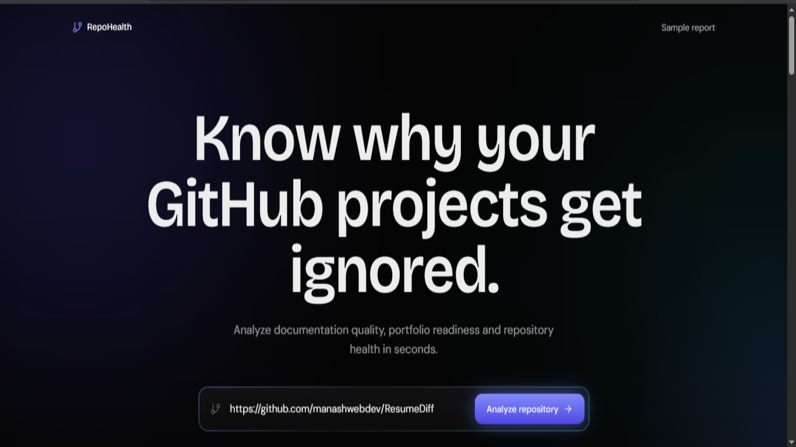
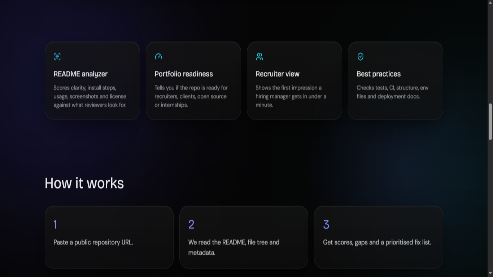

# GitHub Project Health Analyzer

Analyze any public GitHub repository and discover what makes it strong, weak, or portfolio-ready.

GitHub Project Health Analyzer helps developers improve project presentation by evaluating README quality, documentation completeness, portfolio readiness, and overall repository health.

---

## Overview

Many developers spend weeks building projects but lose opportunities because their repositories lack proper documentation, screenshots, setup instructions, or professional presentation.

This tool audits a repository and generates a detailed health report with actionable recommendations.

---

## Features

### README Analysis

* README quality scoring
* Structure evaluation
* Content completeness checks
* Documentation quality insights

### Documentation Gap Detection

Identify missing sections such as:

* Installation Guide
* Usage Instructions
* Features Section
* Screenshots
* Environment Variables
* API Documentation
* Deployment Guide
* Contributing Guide
* License Information

### Portfolio Readiness Review

Evaluate whether a project is:

* Recruiter Ready
* Internship Ready
* Freelance Ready
* Open Source Ready

### Repository Health Report

Generate:

* README Score
* Documentation Score
* Portfolio Score
* Missing Sections Report
* Improvement Suggestions
* Readiness Checklist

---

## Why This Project?

Developers often ask:

* Why does my GitHub project look weak?
* Why aren't recruiters impressed?
* What should I add to my README?
* Is my project portfolio-ready?

This tool answers those questions automatically.

---

## Tech Stack

### Frontend

* Next.js 14
* React
* TypeScript
* Tailwind CSS
* Framer Motion
* Recharts
* Lucide Icons

### Backend

* Node.js
* Express.js

### APIs

* GitHub REST API

---

## Screenshots


### Dashboard Overview


### Health Report


### How It Works


---

## Installation


### Clone Repository

```bash
git clone https://github.com/your-username/github-project-health-analyzer.git
cd github-project-health-analyzer
```

### Install Dependencies

```bash
npm run install:all
```

---

## Environment Variables

Create:

```bash
server/.env
```

Example:

```env
GITHUB_TOKEN=your_github_token
PORT=4000
```

The GitHub token is optional but helps avoid rate limits.

---

## Run Locally

### Start Backend

```bash
npm run dev:server
```

Backend:

```text
http://localhost:4000
```

### Start Frontend

```bash
npm run dev:client
```

Frontend:

```text
http://localhost:3000
```

---

## How It Works

1. Paste a GitHub repository URL.
2. The application fetches repository data.
3. Documentation quality is analyzed.
4. Missing sections are detected.
5. Repository health scores are generated.
6. Actionable recommendations are displayed.

---

## Example Report

### README Score

```text
82 / 100
```

### Documentation Gaps

```text
❌ Missing screenshots
❌ Missing deployment guide
❌ Missing API documentation
```

### Portfolio Checklist

```text
✅ Clear description
✅ Setup guide
✅ Features section
❌ Screenshots
❌ Architecture section
❌ Live demo
```

---

## Project Structure

```text
github-project-health-analyzer
│
├── client
│   ├── app
│   ├── components
│   ├── lib
│   └── package.json
│
├── server
│   ├── analyzer.js
│   ├── index.js
│   └── package.json
│
└── README.md
```

---

## Future Improvements

* AI-powered README rewriting
* Architecture analysis
* Repository comparison mode
* ATS-style project scoring
* GitHub profile auditing
* Team project analysis
* Resume integration

---

## Contributing

Contributions are welcome.

1. Fork the repository
2. Create a feature branch
3. Commit changes
4. Open a pull request

---

## License

MIT License

---

## Author

**Manash Khati**

GitHub:

https://github.com/manashwebdev

---

## Support

If you found this project useful, consider giving it a ⭐ on GitHub.

It helps more developers discover and improve their repositories.
